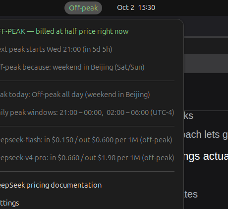

# DeepSeek Peak Hours

A GNOME top-bar indicator that answers one question at a glance: **is the DeepSeek API billing at peak rates right now, and when does that change?**

It sits in the top bar next to the clock on Ubuntu, like the clock does.


And this is the menu, opened from a real session:



Click it:

```
┌────────────────────────────────────────────────────────┐
│ OFF-PEAK — billed at half price right now              │
│ Next peak starts Thu 01:00 (in 5d 5h)                  │
│ Off-peak because: weekend in Beijing (Sat/Sun)         │
│ ────────────────────────────────────────────────────── │
│ Peak today: Off-peak all day (weekend in Beijing)      │
│ Daily peak windows: 01:00 – 04:00, 06:00 – 10:00 (UTC) │
│ ────────────────────────────────────────────────────── │
│ deepseek-flash: in $0.150 / out $0.600 per 1M (off-peak)│
│ deepseek-v4-pro: in $0.660 / out $1.98 per 1M (off-peak)│
│ ────────────────────────────────────────────────────── │
│ DeepSeek pricing documentation                         │
│ Settings                                               │
└────────────────────────────────────────────────────────┘
```

The same rules are also available as a terminal command.

## The rules

Taken from the [DeepSeek pricing documentation](https://api-docs.deepseek.com/quick_start/pricing/):

- Peak rates are **01:00–04:00** and **06:00–10:00 UTC**, Monday to Friday.
- Peak rates are exactly **2×** off-peak rates.
- **Weekends** (Saturday and Sunday, Beijing time) are off-peak all day.
- **Chinese public holidays** are off-peak all day.

The verdict is always computed on UTC, so it is identical everywhere. Your timezone
only changes which clock you read it on, never the answer. This matches the
reference implementation at [seekpeak.dev](https://seekpeak.dev/).

## Install

```bash
./install.sh          # install and enable
```

Then, so GNOME Shell notices the new extension:

- **X11:** press `Alt`+`F2`, type `r`, press `Enter` (or send the shell a `SIGHUP`).
- **Wayland:** log out and back in.

The installer has already registered the extension as enabled, so it starts on its
own; no `gnome-extensions enable` is needed. If you prefer to be explicit after the
reload:

```bash
gnome-extensions enable deepseek-peak@akuma.dev
```

That reload is the only manual step, and only because a running GNOME Shell does
not rescan the extensions directory for newly installed extensions.

Other forms:

```bash
./install.sh --link       # symlink instead of copy, for editing in place
./install.sh --zip        # also build deepseek-peak@akuma.dev.zip
./install.sh --uninstall  # remove the extension and its settings
```

## Using it

**Left click** opens the menu shown above: current rate, the next rate change on
your own clock, why the current rate applies, today's peak windows, current
per-1M-token prices, and the pricing documentation.

**Right click** opens Settings.

### Settings

| Setting | Default | Notes |
| --- | --- | --- |
| Label | `Peak` / `Off-peak` | Or the next change time, a dot, your local clock, or nothing |
| Colour the label | on | Green off-peak, amber peak |
| 12-hour clock | off | AM/PM in the menu |
| Notify when the rate changes | on | One desktop notification per boundary |
| Refresh the holiday list daily | on | Downloads a public list so future years stay correct |

Everything can also be set from the command line. A user-installed extension's
schema lives in its own directory, which `gsettings` does not search, so point it
there (a shell alias is worth it):

```bash
SCHEMA=~/.local/share/gnome-shell/extensions/deepseek-peak@akuma.dev/schemas
GSETTINGS_SCHEMA_DIR=$SCHEMA gsettings list-keys org.gnome.shell.extensions.deepseek-peak
GSETTINGS_SCHEMA_DIR=$SCHEMA gsettings set org.gnome.shell.extensions.deepseek-peak panel-mode 'time'
GSETTINGS_SCHEMA_DIR=$SCHEMA gsettings set org.gnome.shell.extensions.deepseek-peak colourise false
```

Changes apply to the indicator immediately. Valid `panel-mode` values: `words`,
`time`, `dot`, `clock`, `none`. `gsettings reset` restores a default. (Without the
schema directory the shell still reads your values fine — this matters only for
`gsettings` and `dconf-editor`.)

## Terminal command

```bash
./bin/deepseek-peak                  # the full picture
./bin/deepseek-peak --summary        # one line
./bin/deepseek-peak --json           # machine readable
./bin/deepseek-peak --prices         # per-1M-token prices at the active rate
./bin/deepseek-peak --watch          # print a line whenever the verdict changes
./bin/deepseek-peak --at 2026-10-05T02:00:00Z   # evaluate a specific instant
./bin/deepseek-peak --timezone Asia/Tokyo --hour12
```

```
$ ./bin/deepseek-peak --summary
OFF-PEAK — 2x cheaper · next peak Thu 01:00 (in 5d 5h) · weekend in Beijing (Sat/Sun)
```

## Holiday data

Weekends fall out of the calendar. Chinese public holidays do not, so the
extension carries the State Council list for 2026
([国办发明电〔2025〕7号](https://www.gov.cn/zhengce/zhengceku/202511/content_7047091.htm))
and, by default, refreshes that list once a day from a public feed. Only *holiday*
days matter: make-up workdays (调休) that land on a weekend stay off-peak, because
the rule keys off the weekend itself.

The 2027 notice has not been published yet, so until it is, dates past
**2026-12-31** are treated as ordinary weekdays and the menu says so:

```
Holiday list ends 2026-12-31: later days assume no holiday
```

The daily refresh picks up 2027 automatically once the feed carries it. To supply
your own dates instead:

```bash
gsettings set org.gnome.shell.extensions.deepseek-peak auto-update-holidays false
gsettings set org.gnome.shell.extensions.deepseek-peak holiday-overrides "$(printf '2027-01-01\n2027-02-06\n')"
./bin/deepseek-peak --holiday-file my-dates.txt
```

## Layout

```
extension/                 the GNOME Shell extension (this directory is what gets installed)
  metadata.json            uuid, shell-version 45–48, settings schema
  extension.js             panel indicator, menu, timers, notifications
  prefs.js                 the Settings window (libadwaita)
  lib/data.js              peak windows, holiday calendar, price tables
  lib/core.js              pure verdict logic: isPeak, reason, nextTransition
  lib/format.js            verdict -> text, on any timezone
  schemas/                 the GSettings schema
lib/                       Python twins of data.js / core.js / format.js
bin/deepseek-peak          terminal command
tests/                     shared test vectors + JavaScript and Python suites
smoke/                     headless GNOME Shell stubs and harness
docs/                      verification screenshots
AGENTS.md                  agent contract: constraints, layout, sharp edges
ARCHITECTURE.md            layering, data flow, testing strategy
TESTING.md                 automated layers + live session checklist
PROGRESS.md                dated changelog
install.sh, Makefile
```

The running extension is the **copy** at
`~/.local/share/gnome-shell/extensions/deepseek-peak@akuma.dev/`, not this
directory — GNOME Shell only loads extensions from its own location. Edit here,
then `./install.sh` and reload the shell. `./install.sh --link` symlinks instead
so edits land in place.

`extension/lib/*.js` and `lib/deepseek_peak_*.py` are deliberate twins: the same
rules implemented twice, pinned to the same expected answers by
`tests/vectors.json`, so they cannot drift apart unnoticed.

See `AGENTS.md` for the constraints and the GNOME 46 API sharp edges, and
`ARCHITECTURE.md` for how the pieces fit together.

## Tests

```bash
make test     # JavaScript logic, Python logic, headless smoke tests
make lint     # schema, shell, and module parse checks
```

What is covered:

- **Rules** (`node --test tests/core.test.mjs`, `python3 -m unittest discover -s tests`).
  Shared vectors for window edges, weekends, holidays, and timezone-independent
  verdicts; every transition must land exactly on a UTC window edge; no Beijing
  weekend or holiday may ever be peak; the Python implementation is diffed against
  the JavaScript one.
- **Add-on behaviour** (`smoke/`). The real `extension.js` and `prefs.js` loaded
  against stub GI/Shell modules, checking panel placement (centre box, immediately
  left of the clock), label and menu contents, live settings changes, the refresh
  timer, notifications, and that `disable()` leaves no timer or signal handler
  behind. Run it with `TZ=UTC`, since it asserts on clock text.

`make test` needs Node 20+ and Python 3.10+; neither is needed at runtime.

## Gotchas worth knowing

GNOME 46 changed two things that bite panel indicators, and both cost this
extension a debug cycle:

- **`St.Align` is gone.** Vertical alignment is `Clutter.ActorAlign`, so
  `St.Align.MIDDLE` throws `Align is undefined` at class construction, which the
  shell reports only as `State: ERROR` with the real message in
  `journalctl --user -b | grep deepseek-peak`.
- **`Clutter.ActorAlign` has no `MIDDLE`.** It is `FILL` / `START` / `CENTER` /
  `END`; passing anything else yields
  `Invalid value 'undefined' for property y-align`.

The stubs in `smoke/stubs/` deliberately reproduce both restrictions, so a
mistake fails `make test` instead of only failing inside a live session.

## Notes

The indicator reads no network data to decide the verdict — the rules and the
holiday dates are local. The only network request is the once-a-day holiday feed,
which fails silently when offline and leaves the bundled list in place.

Not affiliated with DeepSeek. Rule reference: [seekpeak.dev](https://seekpeak.dev/).
